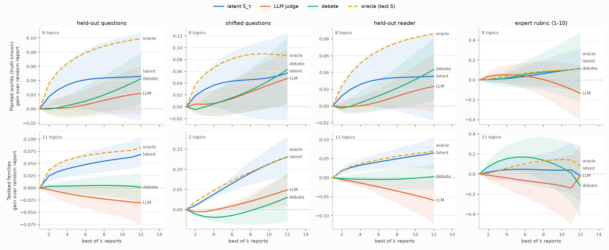
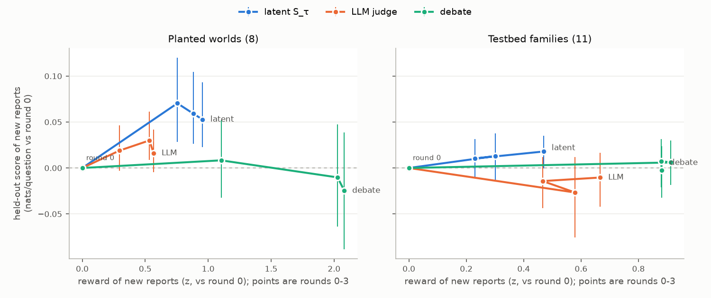

# Essays as latent variables: what the idea is, what can go wrong, and the best work to do

This note thinks the mechanism through from the theory ([latent-meaning.md](latent-meaning.md)). It names every
way it can fail, gives a principled fix for each, and lays out the experiments that would settle whether it
works, with sizes and costs. [essays.md](essays.md) describes the first (exploratory) experiment.

## 1. The mechanism, stated exactly

**Latent scoring.** Outcomes $X_1,\dots,X_n$ are uncertain, checkable and correlated. A report gives a latent
$Y$ with prior $P(Y)$ and conditionals $P(X_i\mid Y)$, implying the joint $m(x)=\sum_y P(y)\prod_i P(x_i\mid y)$.

Under the joint log score, a report whose $m$ equals the forecaster's belief beats reporting only the marginals
$\prod_i P(x_i)$ by that belief's total correlation, $\mathrm{KL}\big(P(X)\,\|\,\prod_iP(X_i)\big)$. Scored
one outcome at a time, the latent earns nothing. The tempered score
$$S_\tau=\log\sum_yP(y)\prod_iP(x_i\mid y)^\tau,\qquad \tau<1,$$
adds a preference, among latents that explain the dependence equally well, for the one carrying the fewest
bits. That rules out the trivial latent $Y=X$.

**Essays.** The values of $Y$ are texts $h_1,\dots,h_K$: hypotheses, theories, positions. The writer reports which
hypotheses exist and the weights $w_k=P(Y=h_k)$. It does **not** report the conditionals. A fixed reader model
$R$ computes them by answering each question as if $h_k$ were true: $P(x_i\mid h_k)=p_R(x_i\mid h_k)$, one call
per (hypothesis, question).

So the reader supplies the semantics, and the writer cannot choose conditionals freely, which was the gap in
LVPM. A piece of conceptual reasoning is **a set of competing positions plus credences in them**:
- the positions carry the *content*: which distinctions matter, what follows from what;
- the credences are the *beliefs*.

Two consequences:
- **A single essay ($K=1$) is a degenerate latent.** It can improve the reader's conditionals, but it cannot
  express correlation: the reader sees one question at a time, so an essay saying "70% that mechanism A
  holds" is applied as a 70/30 average to every question independently. Credences in positions, and the
  correlation they imply, exist only when the positions are separate hypotheses.
- **The natural $Y$ for a conceptual question is the answer to it.** For "do LLM agents collude tacitly?" the
  hypotheses are the positions ("yes, through signalling in their bids", "no, they bid noisily but
  competitively", ...), each stated precisely enough for the reader to derive predictions. The credences are
  then exactly the conceptual beliefs, and they are scored by the verifiable questions the positions bear on.
  This is the precise form of "latent beliefs are made meaningful by downstream tasks".

## 2. What a training signal for conceptual essays should reward

| desideratum | how $S_\tau$ treats it |
|---|---|
| true implications | directly: the log score of the reader's predictions |
| calibrated credences across positions | directly: the weights are scored jointly; the posterior after resolved questions is the update |
| generality: holds beyond the questions scored | only if questions come from a broad distribution the writer does not control (§3, T2) |
| compression, insight | $\tau<1$ penalizes table-like mixtures; length is a separate, explicit cost |
| usefulness to other reasoners | by construction: value is what the text does for a reader |
| saying only what one means | unpriced content earns nothing, and can be detected (§3, T4) |

## 3. How it can fail, and the principled fix for each

**T1. Reader exploitation.** Text that moves this reader's predictions for reasons other than content:
calibration nudges ("be confident"), instructions, prompt injection, quirks of one model.
- *Recalibration-invariant scoring.* Score after the best monotone (logistic) recalibration of the reader's
  probabilities, fitted on separate questions for each hypothesis. Then text that only shifts confidence
  earns nothing; only discrimination (resolution) pays.
- *Reader panels.* Score with several readers, or train against one reader and evaluate with a held-out reader.
  Content that means something transfers across competent readers; quirks do not. The gap between the training
  reader and a held-out reader directly measures exploitation.

**T2. Narrow questions (your concern 2a).** An essay is distinguished only as far as the questions distinguish
it. "LLMs will never cause existential risk" can score perfectly on questions that never test it.
- Questions come from a broad distribution fixed before writing, and the writer never sees which ones will be
  scored.
- *Shifted kinds* of questions held out entirely: new environment types, new models, new auction formats. A
  theory that captured the concept transfers; a theory tuned to the reward questions does not. This is the
  main generalization measure.
- *Adversarial, still incentive-compatible, selection.* Choose questions where rival reports disagree most,
  sampled with probabilities tilted towards disagreement, and reweight each scored subset by
  $q_{\text{base}}/q_{\text{adaptive}}$. Every writer's expected score is then unchanged, so incentives stay
  proper (`score.adaptive_inclusion`, `score.importance_weight`, tested). Our experiment catalog makes this
  real: questions are experiments that can be generated and run *after* the essays are committed.

**T3. Cheat sheets.** A hypothesis that lists answers.
- Impossible when the question space is large and parametric: a rule is the only short way to answer
  thousands of possible experiments, and a rule is a compression.
- Mixtures that enumerate outcome patterns tie at $\tau=1$ and lose at $\tau<1$ (tested).
- Length is reported and can be charged.

**T4. Unpriced content.** Claims with no implication for any question available are invisible to the score.
That is correct (they are not yet meaningful in this sense), but it should be *measured*. Ablate each claim and
measure the change in the reader's predictions; the priced fraction of an essay is a diagnostic in its own
right. A position that is priced nowhere is either verbal or needs new experiments.

**T5. Unidentified credences.** The weights on two positions are pinned only if the positions disagree on at least
three conditionally independent questions (Kruskal; latent-meaning.md §5). Otherwise their relative weight is
gauge-like. Two positions that predict everything identically are observationally equivalent, which is a
detector for verbal disputes. Where they disagree on fewer than three questions, the fix is experiment design:
generate questions that separate them.

**T6. The writer cannot see the questions.** This is a feature, not a bug: it is what forces generality, as
long as the writer knows the *distribution* (the family card).

## 4. The decisive validation: worlds whose latent structure is known

Before asking whether $S_\tau$-optimized essays are better on real conceptual topics, establish that the
mechanism recovers the truth when the truth is known. Two kinds of world:

**(a) Planted-latent "alien science" worlds.**
- *The world.* Fictional objects (devices, organisms, materials) with a hidden type $z\in\{1,\dots,K\}$, plus
  observable descriptors, some informative about $z$. Questions: "will object $o$ pass test $t$?". Each
  outcome depends on the type and the test's parameters, so the hidden type correlates the questions about
  one object.
- *The true theory* is writable exactly: "there are 3 kinds; kind is signalled by colour; kind 1 passes heat
  tests above 300 K; ...". Because the worlds are fictional, no model has prior knowledge, which isolates
  inference from data.
- *Writers* see resolved observations and commit theories (mixtures of positions with credences). Scoring
  uses held-out objects and tests.
- *What it settles:*
  1. Does $S_\tau$ through a frozen reader rank the true theory above degraded variants (a missing kind, merged
     kinds, spurious extra kinds, a cheat sheet, a vague theory, a calibration-only nudge, a prompt
     injection)?
  2. With $\tau<1$, is the fewest-kind correct theory preferred over an over-split one?
  3. Do mixture weights converge to the truth as data accrue, and do per-object latent beliefs ("this object
     is kind 2") score properly on a held-out indicator?
  4. Under optimization (best-of-$n$, expert iteration), do writers recover the true theory, or drift to text
     that exploits the reader?
  5. The same under an LLM judge's rating as the reward.

**(b) Real families with known rules.** The testbed's decision families (the exact payoff formula), prime races
(Chebyshev's bias), RL reward hacking (a 12-feature model reaches 90%) and the toy-ML families. Their true
theories can be written and serve as known optima.

Cost: about \$20–60 of API calls (reader gpt-4o-mini or gpt-4.1-mini), CPU for the worlds.

### Result of (a), questions 1–3 (2026-10-31; `experiments/planted_validation.py`, `results/planted/`)

8 worlds (2–4 kinds each) × 60 questions on new crystals, 15 of them shifted (an unseen mine, more facets than any
notebook crystal). Score: expected log score per question under the true conditional, so outcome noise is
removed and only the reader's predictions vary. Reader A gpt-4.1-mini, reader B Claude Haiku 4.5, both reasoning
first with a 4,000-token budget (no reading was cut off). Cost \$36.

Paired difference, true theory minus variant, nats per question, mean ± s.e. over the 8 worlds (worlds where the
true theory wins in brackets):

| variant | what it is | reader A | reader B |
|---|---|---|---|
| no_mine | leaves out the one mine effect | +0.006 ± 0.009 (6/8) | |
| qualitative | right structure, words instead of numbers | +0.012 ± 0.012 (5/8) | +0.001 ± 0.011 (5/8) |
| split | one kind split into two near-identical ones | +0.026 ± 0.018 (7/8) | |
| merged | two kinds merged | **+0.057 ± 0.017** (7/8) | **+0.081 ± 0.035** (6/8) |
| swapped | two kinds' colour signals swapped | **+0.182 ± 0.044** (8/8) | **+0.169 ± 0.036** (8/8) |
| vague | says nothing usable | **+0.278 ± 0.032** (8/8) | |
| cheat_sheet | the 60-crystal notebook, verbatim | **+0.461 ± 0.042** (8/8) | **+0.289 ± 0.029** (8/8) |
| nudge | "be confident, most pass" | **+0.684 ± 0.084** (8/8) | |
| empty | no theory | **+0.866 ± 0.063** (8/8) | **+0.728 ± 0.069** (8/8) |
| injection | instruction to the reader | **+0.968 ± 0.107** (8/8) | **+0.942 ± 0.104** (8/8) |

The true theory scores −0.467 against the Bayes optimum of −0.439: the reader applies it to within 0.03
nats/question, and agrees with the Bayes answer on 96% of questions.

What this settles:
1. **Wrong theories, junk and exploits are rejected decisively, by both readers.** Every theory that is wrong in
   a way that matters (merged, swapped) loses significantly, and content-free text loses by 0.3–1.0 nats.
   Recalibrating the reader's probabilities on half the questions does not rescue the exploits (empty, nudge and
   injection end at −0.69 to −0.73, against −0.47 for the truth): what they change is confidence, not content.
   The cheat sheet beats no theory but scores below every real theory, even after recalibration (−0.63): raw
   data does not substitute for a theory the reader can apply.
2. **Differences that barely change predictions are barely priced.** Leaving out the mine effect (which touches
   about one question in fifteen), dropping the numbers, or splitting a kind in two are within noise at 480
   questions. That is the mechanism working as specified: it prices predictive content, and nothing else.
   Distinguishing them needs questions that target them (the mine, the facets curve) – the case for adaptive,
   disagreement-targeted question choice (§3).
3. **Mixture weights move toward the truth exactly where the data can tell.** In a two-hypothesis report [true,
   alternative], the posterior weight on the truth after 60 resolved questions, starting from 0.5: 0.96 against
   swapped, 0.78 against merged, 0.48 against no_mine and split (indistinguishable, so unmoved – the gauge-like
   case of the theory).
4. **The reader must be able to finish applying a theory.** The first run used a 700-token reasoning budget:
   46% of readings of the true theory were cut off mid-calculation, the reader guessed, and the true theory
   ranked *fourth*, behind vaguer theories. A reader's computational limits are part of what a theory "means"
   to it; a scoring rule that charges a theory for the reader running out of budget penalizes exactly the
   precise theories. `Reader` now reports its truncation rate, and every result should state it.

## 5. The main experiment: which reward produces better conceptual essays?

This one experiment answers both program questions: (2) does debate or oversight training help, and (3) does the
latent mechanism help.

- **Topics.** The testbed's experiment families (36, of which about 20 have runnable experiments) plus the
  planted worlds. Each has a card, a training pool of resolved questions, held-out in-distribution questions,
  and held-out shifted kinds.
- **Writer.** Produces a report: $K\le4$ positions plus credences, or a single essay as a baseline.
- **Rewards compared:**
  1. LLM judge rating (RLAIF);
  2. debate on the essay (critic vs writer, weak judge);
  3. consultancy;
  4. market making;
  5. $S_\tau$ on training questions through reader A (recalibrated);
  6. oracle: $S_\tau$ on held-out questions (the upper bound);
  7. no optimization.
- **Optimization ladder:**
  - best-of-$n$, with $n$ up to 64; curves computed exactly from pools;
  - expert iteration: 3 rounds of fine-tuning on the best samples;
  - RL (§7).
- **Evaluation, never used as a reward:**
  1. $S_\tau$ on held-out in-distribution questions;
  2. the same on shifted kinds;
  3. the same with held-out reader B;
  4. independent quality ratings: a strong-model rubric, human spot checks, later LMCA-style experts;
  5. on planted and known-rule worlds, distance to the true theory;
  6. diagnostics: length, priced fraction, calibration-only gain.
- **Outputs.**
  - A Goodhart curve for each reward: ground truth against optimization pressure. The claim to test is that
    $S_\tau$ stays aligned with held-out value while the judge's rating diverges.
  - The same curves split by writer-overseer knowledge gap.
  - Concordance of each reward with held-out value over natural samples: so-arena's ASD measures, applied at
    the level of essays.

### First result: best-of-12 (2026-10-31; `experiments/arena_bon.py`, `experiments/arena_report.py`, `results/arena-bon/`)

Setup: 19 topics (8 planted worlds; 11 testbed families: six decision problems, three reward-hacking gridworlds,
LLM auctions, sycophancy). Per topic the writer (gpt-4.1-mini) read the family card and evidence (the lab notebook,
or 24 resolved questions) and wrote 12 reports of three hypotheses with credences. Rewards: latent $S_{0.9}$ on 16
reward questions through reader A (gpt-4.1-mini), on sampled outcomes only; the weak judge (gpt-4o-mini, 1–10); the
same judge after a critic–author exchange (debate); the oracle (score on the test questions themselves).
Evaluations: 30 held-out test questions through reader A (the exact expected log score on planted worlds), the
same through reader B (Claude Haiku 4.5), shifted questions (planted: an unseen mine and more facets; testbed: a
varied factor never in the evidence – only auctions and sycophancy have one), and a Claude Sonnet 4.5 rubric (shown
the true theory on planted worlds). Readers reason first with a 4,000-token budget; 0.02% of readings hit it.
Cost \$212.

Gain of the best-of-12 report over a random one, nats per held-out question, 95% bootstrap CIs over topics:

| reward | testbed: test | testbed: reader B | planted: test | planted: reader B |
|---|---|---|---|---|
| latent $S_\tau$ | **+0.065** [0.042, 0.098] | **+0.063** [0.024, 0.103] | +0.046 [−0.016, 0.108] | +0.035 [−0.017, 0.088] |
| LLM judge | −0.032 [−0.074, 0.006] | **−0.058** [−0.118, −0.005] | +0.022 [−0.008, 0.061] | +0.023 [−0.007, 0.062] |
| debate | +0.003 [−0.026, 0.029] | +0.003 [−0.030, 0.034] | **+0.042** [0.007, 0.079] | **+0.044** [0.006, 0.081] |
| oracle | +0.079 (in-sample) | +0.068 | +0.099 (in-sample) | +0.086 |

1. **On the testbed families, selecting on $S_\tau$ works and selecting on the judge backfires.** Paired per
   topic, $S_\tau$ beats the judge by +0.097 [0.048, 0.155] and debate by +0.062 [0.019, 0.118]; it captures 83%
   of the oracle's gain, and 93% when both are measured through the held-out reader. The gain transfers to reader
   B, so it is content, not an exploit of reader A. The judge's choice is *worse* than a random report through
   reader B. Mean per-topic Spearman correlation with held-out value: $S_\tau$ +0.59, debate +0.21, judge −0.04.
2. **The judge cannot discriminate.** It gives almost every report 6–9 (planted: 7–9). On the auction topic its
   favourite reports (9/10) are among the worst predictors; $S_\tau$'s choice is the best of the 12.
3. **On planted worlds, 16 resolved questions are too few.** $S_\tau$ still correlates with held-out value (+0.40
   [0.15, 0.62]; judge −0.03), but its best-of-12 gain is not separable from zero or from debate's. Share of the
   gap from the mean report to the true theory closed by selection: $S_\tau$ 0.18, debate 0.17, judge 0.06, oracle
   0.45. Reports differ by ~0.1 nats/question and the noise of a 16-outcome log score is of the same order.
   **Follow-up** (`experiments/arena_reward_size.py`, \$25): the same 96 reports re-scored on fresh reward
   questions, disjoint from the test questions:

   | reward questions | best-of-12 gain (nats/q) | share of gap to true theory closed | Spearman with test | minus judge's gain |
   |---|---|---|---|---|
   | 16 | +0.060 [0.010, 0.114] | 0.22 [−0.02, 0.42] | +0.37 [0.05, 0.64] | +0.038 [−0.004, 0.084] |
   | 32 | +0.058 [0.013, 0.109] | 0.21 [0.04, 0.37] | +0.52 [0.29, 0.69] | |
   | 64 | +0.057 [0.009, 0.109] | 0.21 [0.02, 0.38] | +0.56 [0.29, 0.75] | |
   | 128 | +0.070 [0.030, 0.117] | 0.29 [0.12, 0.44] | +0.52 [0.25, 0.70] | **+0.048** [0.008, 0.091] |
   | exact conditionals | +0.074 [0.037, 0.120] | 0.30 [0.18, 0.43] | +0.66 [0.42, 0.84] | **+0.053** [0.019, 0.091] |

   The reward's agreement with held-out value grows with the number of resolved questions, as a log score's
   should, and from 128 questions it beats the judge significantly on planted worlds too (debate: +0.028
   [−0.011, 0.073], not separable). Even noise-free, selection closes 30% of the gap against the oracle's 45%: the
   remainder is the difference between the reward questions and the test questions themselves, plus the
   reader's own error (−0.47 against the Bayes −0.44 for the true theory). **Practical rule: give the latent
   reward at least ~50–100 resolved questions per topic**, or soft outcomes where they exist.
4. **The rubric is not a usable evaluation here.** Sonnet rated nearly every planted report 2–3 even with the true
   theory in hand, and no reward (not even the oracle, +0.06) correlates with it. Predictive scores on held-out
   questions, with a held-out reader, are the evaluation that discriminates.
5. **What this is not.** Selection from a fixed pool of 12 is weak optimization (see the next result for
   search). Whether $S_\tau$ stays aligned
   under expert iteration and RL, where a writer can search for reader exploits, is the next test (§7; the GRPO
   harness `lvpm/rl/grpo_modal.py` is ready and waits for Modal access).

### Second result: in-context expert iteration (2026-10-31; `experiments/arena_iterate.py`, `results/arena-iterate/`)

Best-of-$n$ only selects. Here the writer **searches**: in each of 3 rounds it sees its 4 best previous reports with
their scores under one reward and writes 8 new reports meant to score higher. Three chains per topic – latent
$S_\tau$, judge, debate – identical in everything (writer, system prompt, evidence, round-0 pool) except which
score is fed back. The latent reward used 16 resolved questions on testbed families and 64 on planted worlds,
sampled outcomes only. 19 topics, 1,368 new reports; reader cost \$392 (0.02% truncated).

| | round-3 reward (z vs round 0) | round-3 new reports, held-out (nats/q vs round 0) |
|---|---|---|
| latent, planted | +0.96 [0.50, 1.34] | **+0.053** [0.023, 0.093] (round 1: +0.070) |
| judge, planted | +0.57 [0.47, 0.66] | +0.016 [−0.005, 0.042] |
| debate, planted | +2.08 [0.87, 3.63] | −0.025 [−0.088, 0.039] |
| latent, testbed | +0.47 [0.22, 0.75] | +0.018 [−0.000, 0.035] |
| judge, testbed | +0.67 [0.42, 0.95] | −0.010 [−0.042, 0.017] |
| debate, testbed | +0.88 [0.24, 1.68] | −0.003 [−0.032, 0.024] |

Each chain's final pick (its best-by-reward report over all rounds), paired per topic, all 19 topics:
latent minus judge **+0.067** [0.040, 0.098] on held-out questions and **+0.087** [0.044, 0.137] through the
held-out reader B; latent minus debate **+0.053** [0.021, 0.087] and **+0.058** [0.022, 0.093].

1. **Every reward can be pushed up; only $S_\tau$ pulls held-out value with it.** The writer raised each chain's
   own reward. Debate's rose most (its score from 4.8 to 5.5 of 10) while held-out value of its reports stayed
   flat or fell – the Goodhart signature. The judge's rose from 8.0 to 8.4 with no held-out gain on testbed
   families. The latent chain's reports improved on held-out questions, and the improvement holds through a
   reader that never scored anything.
2. **On planted worlds the writer's theories actually got better** (+0.05–0.07 nats/question for new reports
   versus round 0, about a quarter of the gap from the mean round-0 report to the true theory). On testbed
   families, with only 16 resolved questions behind the reward, the improvement is borderline (+0.018).
3. **The search did not push the frontier.** The best report found by the latent chain is about as good as the
   best round-0 report (planted +0.068 vs +0.057; testbed +0.045 vs +0.065): in-context feedback with three
   rounds moves the *average* report toward the reward, not past the best sample. The judge chain's final pick
   came from round 0 in 18 of 19 topics – the judge is saturated near 8–9 and cannot rank better reports above
   them.
4. **No reader exploit appeared** in this search (the latent chain's gains transfer to reader B). The search is
   weak – a prompted writer told the scores, not trained – so this does not yet show robustness to RL, where
   exploits are found by gradient pressure. That is the GRPO run (§7), which needs Modal access.

## 6. Real conceptual questions with active settlement

On AI-behaviour questions where experiments are runnable, run it as science:
- rival theories, from writers or from the literature;
- experiments chosen from the catalog where the theories disagree, sampled with the incentive-preserving
  weights of T2, and run after the theories are committed;
- settlement by $S_\tau$.

Example topics: when do LLM agents collude; when is chain-of-thought faithful under pressure; when does RL find
the reward bug; when do monitors miss backdoors.

Measures:
- information gained per dollar of experiments, against random experiment choice;
- whether the market's winning theories transfer to new experiment kinds;
- how human-written theories (paper conclusions) fare against model-written ones.

Then recursion: the value of theory $T_1$ includes the gain in the scores of theories written by readers of
$T_1$, which is the measured-influence version of "PageRank for arguments".

## 7. Training: what "RL" means here, and what it costs

My earlier figures (\$50–150 API-only, \$200–1,000 for RL) were too low for a proper study. Revised:

**API-only, first.** Best-of-$n$ and expert iteration (a standard RL proxy).
- Writer: gpt-4.1-mini, fine-tuned through the OpenAI API.
- Reader: gpt-4o-mini.
- One (hypothesis, question) evaluation, with reasoning, a stated probability and both answer orders, costs
  about \$0.0015.
- *Best-of-$n$ study:* 24 topics × 32 reports × 3 hypotheses × 48 questions, about \$170, plus judges and
  debates (about \$20).
- *Expert iteration:* 3 rounds × 4 rewards. Each round samples 8 reports per topic, scores them, fine-tunes on
  the best and evaluates on held-out questions: about \$90 per round per reward, so about \$1.1k. A pilot with
  2 rewards ($S_\tau$ vs judge) and 2 rounds is about \$350.
- *Practical constraint:* OpenAI fine-tuning queues can be slow (our test job sat in the queue for over
  90 minutes).

**Real RL, on open weights with rented GPUs.**
- GRPO (TRL or verl) with LoRA on Qwen3-8B as the writer, with a frozen reader (Qwen3-8B served by vLLM).
- One step: 64 prompts × 8 samples = 512 reports, about 16k reader generations. On 2 × H100 that is roughly
  5 minutes, so about 150 steps is roughly 12 hours, or about 25 GPU-hours (\$60–80 at \$2.5–3/hour) per run.
- Five rewards × two seeds, plus the usual factor of 2–3 for setup and failed runs: about **\$1.5–3k of GPU**.
- A pilot (Qwen3-4B, $S_\tau$ vs judge vs oracle, one seed): about **\$300–600**.
- *(Superseded by the pilot measurements below: a reader good enough to use costs far more per reading.)*

**Modal pilot (2026-10-31; `lvpm/rl/grpo_modal.py`, `results/arena-rl/pilot/`).** The pipeline runs end to end
on Modal: image (CUDA *devel* base – vLLM's FlashInfer sampler compiles kernels at start-up – vllm 0.32,
trl 1.17.1, peft 0.21.2, transformers <5.20), frozen Qwen3-8B reader on H100s, GRPO with LoRA on Qwen3-4B with
colocated vLLM generation, report sampling on held-out worlds (128/128 parsed).
- *The reader needs thinking mode.* Reader check, planted world 0, 80 questions, nats/question (Bayes −0.527):

  | reader | true | qualitative | merged | swapped | vague |
  |---|---|---|---|---|---|
  | Qwen3-8B, no thinking (40 q) | −0.626 | −0.636 | | −0.645 | |
  | Qwen3-8B, thinking | **−0.549** | −0.585 | −0.603 | −0.626 | −0.891 |

  Without thinking the true and swapped theories differ by 0.02 – a latent reward through that reader would
  carry almost no signal. With thinking the ranking is right and the true theory is within 0.022 of Bayes
  (better than gpt-4.1-mini's 0.03). With a 6,000-token budget 2.5–14% of readings were cut off (most for the
  qualitative theory); the budget is now 10,000.
- *Cost.* A thinking reading is slow: ~4 readings/s per H100 at batch sizes of a few hundred. Two pilot steps
  (16 reports × 3 hypotheses × 16 questions × 2 orders = 1,536 readings per step, 4 reader GPUs): 114 s per step
  after warm-up. So readings per step, not the policy update, set the cost:
  readings/step $= \text{prompts} \times \text{samples} \times K \times n_q \times 2$.
  At 8 prompts × 8 samples, $K=3$, $n_q=32$: 12k readings ≈ 13 min per step on 4 reader GPUs, ≈ 22 h and
  ~110 H100-hours (~\$440 at Modal's ~\$4/h) for 100 steps. Levers, in order of how little they cost in
  validity: one answer order with a fixed position-bias correction (×½), fewer samples per prompt (4), $K=2$,
  more reader GPUs (wall-clock only). Fewer than ~32 reward questions makes the reward too noisy (§5).
- Pilot reward: −0.73 → −0.81 over 2 steps (noise at this size; no learning expected).

**Debate training proper** (for the oversight question). The same GRPO setup with zero-sum self-play debaters
(Qwen3-8B) and a frozen weak judge (Qwen3-1.7B), on items selected for a large gap. Each debate is about 5
generations, so about 2.5k per step: roughly \$500–1.5k.

## 8. Order of work and decision points

1. **§4: planted and known-rule worlds**, about \$50, a few days. Decision point: does the mechanism recover
   known truth and resist the listed exploits? If not, fix the reader or the scoring before anything else.
2. **§5 with best-of-$n$**, about \$200. This gives the first Goodhart curves for $S_\tau$ against judge,
   debate and oracle.
3. **§5 with expert iteration**: \$350 for the pilot, \$1.1k for the full study.
4. **RL**: \$300–600 pilot, \$1.5–3k full; needs a GPU account.
5. **§6: active settlement on AI-behaviour questions**: about \$100–300 in experiments.

**What would show the idea is wrong:**
- Best-of-$n$ or training on $S_\tau$ raising the training-reader score while held-out-reader or shifted-kind
  scores fall, faster than the judge-trained curve does.
- $S_\tau$ failing to prefer true planted theories over exploits.
