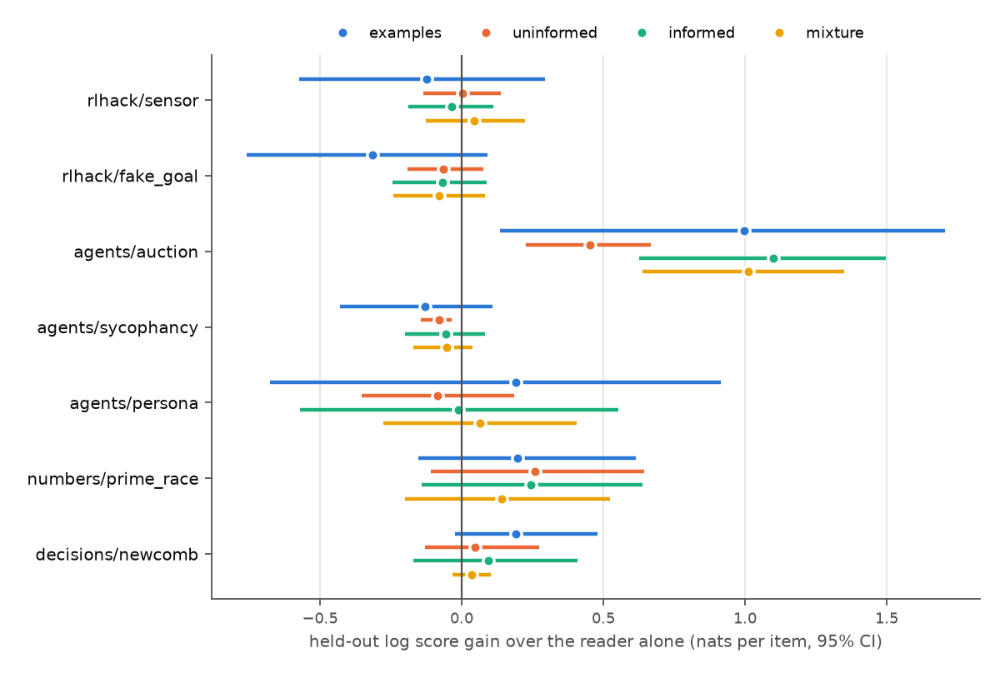

# Essays as latent variables

[latent-meaning.md](latent-meaning.md) argues that a latent belief means what it does to predictions of
observables, and that the tempered log score $S_\tau$ elicits latent structure from one realized outcome.
This note applies that idea to conceptual writing. **An essay is a latent variable, and the questions it
bears on are its indicators.** The essay's value is how much it improves a fixed reader's predictions of
questions its writer never saw.

Code: [`lvpm/essays/`](../lvpm/essays). The questions and their hidden answers come from the testbed in
so-arena (`so_arena.domains.testbed`, documented in `so-arena/docs/testbed.md`). Experiments:
[`experiments/essays.py`](../experiments/essays.py) and
[`experiments/essays_report.py`](../experiments/essays_report.py). Results:
[`results/essays/summary.md`](../results/essays/summary.md).

## 1. The mapping

A **report** is $K$ natural-language hypotheses $h_1,\dots,h_K$ with weights $w_k$. A **frozen reader** $R$, a
fixed model with a fixed prompt, answers each task $i$ as if $h_k$ were true. It is called separately for each
(hypothesis, task) pair, which gives

$$P_{ki}=p_R(y_i=1\mid h_k).$$

On resolved outcomes $y$ the report is paid

$$S_\tau(w,P;y)=\log\sum_{k=1}^K w_k\prod_i p_R(y_i\mid h_k)^\tau .$$

This is the note's $S_\tau$ for the structure $X\to Y_i$:

| latent-meaning.md | here |
|---|---|
| latent state $x$ | hypothesis $h_k$ |
| prior $p(x)$ | weights $w_k$ |
| conditionals $p(y_i\mid x)$ | the reader's predictions $p_R(y_i\mid h_k)$ |
| observables $Y_i$ | testbed outcomes |

Tasks are conditionally independent given the hypothesis *by construction*, because each call sees one task.
Any correlation between tasks has to be carried by the mixture.

**Why the decoupling worry dissolves.** In LVPM a single agent reports both the latent and the conditionals.
It could therefore get the concrete answers right regardless of what its latent says. Here the roles are
separate:

- The writer controls only $h_k$ and $w_k$. It commits before the test tasks are drawn.
- The reader's conditionals are fixed: they *are* the semantics of the essay.
- The only way to raise the expected score on unseen tasks is to say something true and general about the
  domain.

The cost is that meaning becomes reader-relative. I think that is unavoidable; it is the same move as the
agreed likelihood in per-unit scoring (latent-meaning.md, §4b). A reader that ignored its context would make
every essay score the same. That would be a broken instrument rather than an exploit, and it is checked
directly: compare scores against the empty essay.

**Where the information cost lives.** With $K=1$, $S_\tau=\tau\sum_i\log p_R(y_i\mid h)$, so $\tau$ only rescales
the score. The bottleneck's cost term,

$$\mathbb E\,S_\tau \;\leftrightarrow\; -\big[I(H;Y)-\tau\textstyle\sum_i I(H;Y_i)\big],$$

acts through the mixture. For $p<1$, $p^\tau>p$, while a deterministic prediction gets no inflation. So a
report that enumerates outcome patterns ties with a compact report at $\tau=1$, and loses on every outcome at
$\tau<1$ (checked in [`tests/test_essay_score.py`](../tests/test_essay_score.py)). For single essays the
analogous safeguards are external: test tasks are unseen and drawn from a broad family, and essay length is
reported.

**What a mixture buys.** The held-out score
$\log P(y_\text{test}\mid y_\text{dev})=S(y_\text{dev}\cup y_\text{test})-S(y_\text{dev})$ is what a report
earns by updating its weights on resolved tasks and predicting new ones. That is the use a latent belief has.

## 2. Design decisions, and why

- **The reader reasons before answering.** A reader that answers in one token cannot *apply* a theory. In a
  pilot on Newcomb items, gpt-4.1-mini given the exact payoff formula scored 50% without reasoning and 81% with
  it.
- **The reader states a probability after reasoning,** rather than its probability being read from logprobs.
  After reasoning, next-token probabilities are almost always 0 or 1. That would turn every hypothesis into a
  deterministic one and erase the difference between "this is a toss-up" and "certainly A".
- **Position bias is removed** by asking with both answer orders and averaging.
- **Predictions are clipped** to $[0.01,0.99]$, so a confident miss costs at most $\log 100$.
- **Splits are three-way:** SHOWN (resolved items writers may read), DEV (resolved items used only to select
  among essays), and TEST (held out). Selecting on SHOWN would reward memorization, since informed writers
  have seen those answers.
- **Baselines.**
  - `empty`: the reader alone.
  - `examples`: the SHOWN items verbatim with their answers. This is data without theory, and is 4–9 times
    longer than an essay.
  - `uninformed`: an essay written from the family card alone.
  - `informed`: an essay written from the card plus the SHOWN items.
  - `mixture`: three weighted competing hypotheses from the same inputs.

## 3. First results

*Caveat (found 2026-10-31):* these runs gave the reader a 700-token reasoning budget. On planted worlds that cut
off 46% of readings of precise theories (essays-plan §4), so the gains below for long or quantitative essays are
probably understated. The essay arena (`experiments/arena_bon.py`) re-measures with a 4,000-token budget.

Setup: 7 testbed families. Each has 48 items, split 16 SHOWN / 16 DEV / 16 TEST. The reader is gpt-4.1-mini
(reasoning, debiased). Writers are gpt-4.1-mini, gpt-5-mini and Claude Sonnet 4.5. There are 3 informed
essays, 2 uninformed essays and 2 mixtures per writer. Cost: \$1.3 for writers and \$23 for the reader (28k
calls).

Held-out gain over the reader alone, in nats per test item, with 95% bootstrap CIs over items:

| family | reader alone (acc.) | uninformed | informed | mixture | examples |
|---|---|---|---|---|---|
| agents/auction | 0.19 | **+0.45** [0.23, 0.67] | **+1.10** [0.63, 1.50] | **+1.01** [0.64, 1.35] | **+1.00** [0.14, 1.71] |
| numbers/prime_race | 0.69 | +0.26 [−0.11, 0.65] | +0.25 [−0.14, 0.64] | +0.14 | +0.20 |
| decisions/newcomb | 0.81 | +0.05 | +0.09 | +0.03 | +0.19 [−0.02, 0.48] |
| agents/persona | 0.44 | −0.09 | −0.01 | +0.06 | +0.19 |
| agents/sycophancy | 0.88 | **−0.08** [−0.14, −0.03] | −0.06 | −0.05 | −0.13 |
| rlhack/sensor | 0.75 | 0.00 | −0.04 | +0.04 | −0.12 |
| rlhack/fake_goal | 0.81 | −0.07 | −0.07 | −0.08 | −0.31 |

What this shows, with the power it has (16 test items per family):

1. **When the reader's prior is wrong, a theory written from evidence fixes it, and the gain transfers.** On
   the auction experiments the reader alone gets 19% right: it confidently expects the opposite of what LLM
   bidders do. Essays written from 16 resolved experiments raise held-out accuracy to 71% and gain 1.1
   nats/item. Essays written without data gain only 0.45. The informed essays are about 550 words. They match
   or beat the 4,500-word raw examples, with tighter intervals.
2. **Where the reader already reasons well, essays mostly don't help, and can hurt** (sycophancy, the RL
   families). On the RL families no essay beats the reader's own reasoning about each map. Predicting a
   Q-learner seems to need simulation-like reasoning per item, not a portable theory.
3. **Mixtures carry cross-task structure.** Updating a mixture's weights on DEV outcomes improved its TEST
   log score in 29 of 38 mixtures. The mean gain is +0.041 nats/item, 95% CI [0.006, 0.076]. The effect is
   small but positive, which is what a latent that tracks shared structure should do. Tempering ($\tau=0.9$ vs
   1) barely changes predictions (+0.002), as expected: $\tau$ matters for *incentives* between rival reports,
   not for a single report's forecasts.
4. **As a selection signal, DEV $S$ is not yet reliable at this size.** Over informed essays, the Spearman
   correlation of DEV $S$ with TEST $S$ ranges from 0.97 (Newcomb) to −0.53 (fake goal); the LLM judge's rating
   is mostly weaker. Sixteen DEV items is too few to rank essays whose true differences are about 0.1
   nats/item. The best-of-$k$ curves are in
   [`results/essays/selection.png`](../results/essays/selection.png).

## 4. What next

- **Power.** Use 60+ TEST items per family, focused on families where the reader's prior is weak (the agents
  families, prime races, and new LLM-behaviour experiments). Everything is cached, so adding items costs
  only the new reader calls.
- **Training rather than selection.** Use best-of-$N$ and then RL on writers, with DEV $S_\tau$ as the reward.
  Plot held-out $S$ against reward along the run (the Goodhart curve), next to the same curve with an LLM judge
  as the reward.
- **Adaptive task choice.** `score.adaptive_inclusion` and `score.importance_weight` implement
  disagreement-tilted task selection that leaves every writer's incentives unchanged. The next step is to use
  them to spend experiment budget where rival essays disagree.
- **Recursion.** An essay $E_1$'s value is the gain in $S$ of essays written by writers who read $E_1$. This is
  credit assignment on a citation DAG: the measured-influence version of "PageRank for arguments".
- **Real conceptual domains.** For decision theory, the chain ends in payoffs of agents that follow the essay
  in simulated Newcomb-like environments (the `decisions` families). The same harness scores a decision-theory
  essay by the payoffs its readers achieve.
