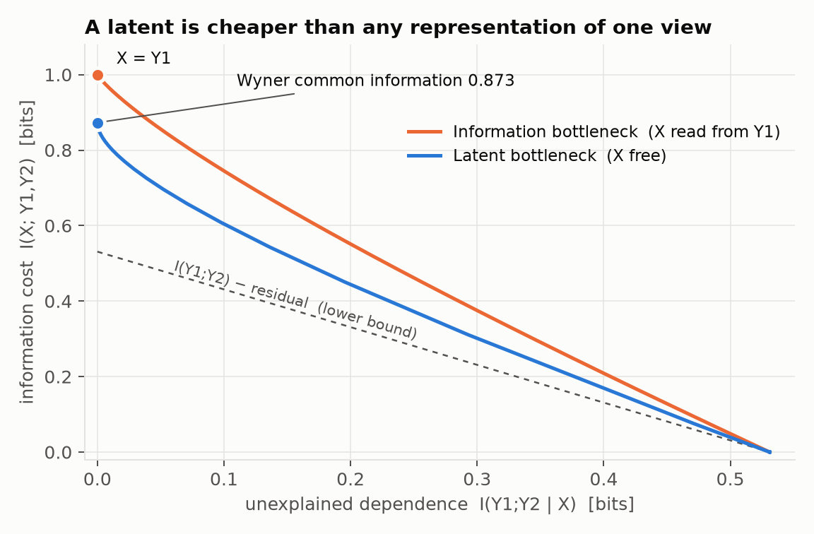
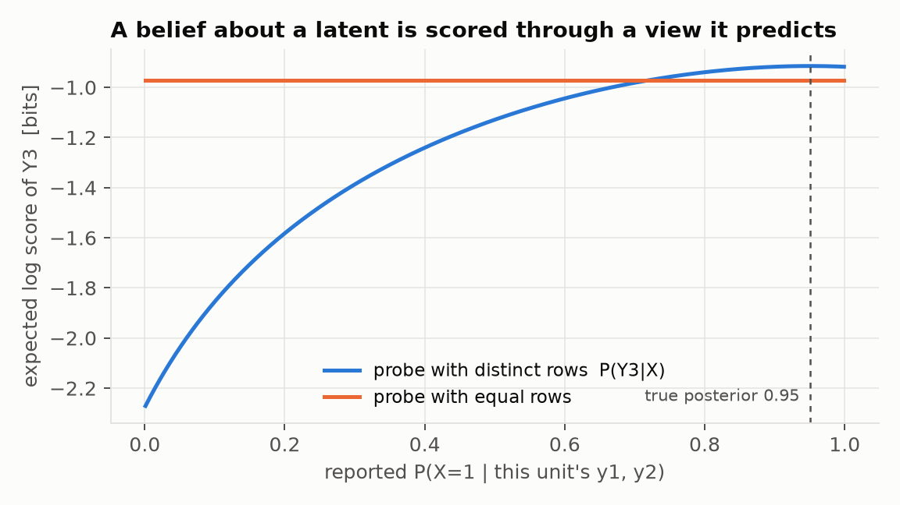

# What gives a latent belief meaning?

A probability for an observable gets its meaning from a proper scoring rule
applied to the outcome. A belief about a latent variable never meets an
outcome. So what makes one latent structure for observables $Y_1,\dots,Y_n$
better than another, and how can latent beliefs be elicited or traded?

## Summary

- **A latent means what it does to predictions of observables.** A scoring rule
  can reward nothing else. Latent beliefs are pinned down exactly as far as the
  observable distribution pins them down (§1, §5).
- **Two quantities grade a latent.** *Unexplained dependence*: how far the
  observables are from being independent given the latent. *Information cost*:
  how much the latent knows about the observables. Total correlation alone
  accepts $X=Y$. The cost term is what rules that out (§2).
- **The latent bottleneck** trades the two off. The information bottleneck is
  the special case where the latent must be computable from one observable
  (§3).
- **What you get from it (§4):**
  - **An algorithm.** Tempered EM fits any latent DAG to $P(Y)$.
  - **An elicitation rule.** The *tempered log score*
    $S_\tau(\theta;y)=\log\sum_h \prod_{v\in H}p_\theta(v|\mathrm{pa}_v)\prod_{v\in Y}p_\theta(v|\mathrm{pa}_v)^{\tau}$
    is a scoring rule on one realized outcome. Its expected value is maximized
    exactly by the bottleneck-optimal latent model. At $\tau=1$ it is the
    ordinary log score.
- **The LVPM proposal** (log market scoring rule on the implied joint) is the
  $\tau=1$ case (§6). It is incentive-compatible, and it prices latent
  parameters exactly when the market's model family identifies them. It does
  not price free-form latent distributions, factor rotations, or extra latent
  classes. $S_\tau$ is a drop-in fix for the last one.

Code: [`lvpm/dag.py`](../lvpm/dag.py) and
[`lvpm/latent_bottleneck.py`](../lvpm/latent_bottleneck.py). Every number below
is reproduced by `experiments/*.py`, with outputs in
[`elicitation.txt`](elicitation.txt), [`results.txt`](results.txt) and
[`wyner_vs_true.txt`](wyner_vs_true.txt).

---

## 1. Setup: scoring sees only the implied distribution of $Y$

A latent structure is a DAG $G$ over hidden nodes $H$ and observed nodes $Y$. A
latent model $\theta$ is one conditional table $p_\theta(v\mid\mathrm{pa}_v)$ per
node. Examples:
- $X\to Y_i$: latent class analysis, or IRT when $X$ is continuous.
- $X\to Z_j\to Y_i$: a hierarchical model.

The model predicts $m_\theta(y)=\sum_h p_\theta(h,y)$. Under any proper scoring
rule, the expected score of $\theta$ depends only on $m_\theta$. Two kinds of
slack follow:

- **Gauge.** Relabeling or reparametrizing a hidden node changes nothing. A
  latent value means "the state with these conditionals". This is harmless,
  and information quantities are invariant under it.
- **Non-identification.** Different latent models can predict the same
  $m_\theta$, for example $X=Y$ in the single-latent case. Such models are
  rewarded identically, so a belief that distinguishes them has no observable
  content. §5 covers when this happens.

## 2. Unexplained dependence and information cost

Let a latent be coupled to the observables, $p(h,y)=p(y)\,q(h\mid y)$, where
$q$ is any "encoder". Two quantities matter.

**Unexplained dependence** is the gap to the best model with structure $G$:
$$D_G=\mathrm{KL}\Big(p(h,y)\,\Big\|\,\textstyle\prod_v p(v\mid\mathrm{pa}_v)\Big)\;\ge 0,$$
where the conditionals are those of $p(h,y)$. For one latent $X$ with
$Y_1,\dots,Y_n$ as children, this is the conditional total correlation
$\mathrm{TC}(Y|X)=\sum_i H(Y_i|X)-H(Y|X)$. It is zero iff the $Y_i$ are
independent given $X$. It equals the log-score regret, on the complete data
$(h,y)$, of the best model with structure $G$, and it upper-bounds the regret
on $Y$ alone. This is the scoring rule's half of the answer.

**Information cost** is $I(H;Y)$: how many bits the latent carries about the
observables.

On your question 1a: $D_G=0$ admits trivial latents. $X=(Y_1,\dots,Y_n)$
explains every dependence perfectly, because each $Y_i$ is a deterministic
function of it. Total correlation alone therefore cannot prefer a real
latent. The cost $I(H;Y)$ is what penalizes such a latent: it costs $H(Y)$ bits,
the maximum. A good latent explains a lot of dependence with few bits.

My earlier phrase "choosing among fits" was imprecise. It describes only the
limiting case: require $D_G=0$ exactly, then minimize cost. That is Wyner's
common information. The general criterion below is a *trade-off*. Its optimum
usually leaves a little dependence unexplained, in exchange for a much cheaper
latent. In the hierarchical example of §4, $\tau=0.8$ keeps 55% of the true
latents' information and loses only 0.076 bits of log score.

## 3. The latent bottleneck

Trade the two off with a weight $\tau\in[0,1)$. For a single latent:

$$\mathcal L_\tau(X)=I(X;Y)-\tau\sum_i I(X;Y_i)\;\;\equiv\;\;\frac{I(X;Y)+\beta\,\mathrm{TC}(Y|X)}{1+\beta},\qquad \beta=\tfrac{\tau}{1-\tau},$$

where $\equiv$ means equal up to a constant. In words: compress all the
observables jointly, while staying informative about each one separately.

For a general DAG, the objective that §4's scoring rule elicits is
$I(H;Y)+(D_H+\tau D_Y)/(1-\tau)$. Here $D_G=D_H+D_Y$ splits the violation into
the part among hidden nodes and the rest.

Known special cases:

| Special case | Known as |
|---|---|
| $\tau\to1$: exact fit ($D_G=0$), then least information | Wyner's common information |
| $\tau=1$, number of latent states fixed | maximum likelihood (EM), CorEx |
| two observables, encoder restricted to read only $Y_1$ | the information bottleneck |

### How it differs from the information bottleneck (question 1b)

In the information bottleneck you are handed $Y_1$ and want to predict $Y_2$.
You build a summary $T$ of $Y_1$: a (possibly randomized) function of $Y_1$
alone, an encoder $p(t\mid y_1)$. "$T - Y_1 - Y_2$" is shorthand for exactly
this: $T$ is computed by looking only at $Y_1$. So once you know $Y_1$, $T$
adds nothing about $Y_2$. Example: $Y_1$ is an image, $Y_2$ its label, and $T$
is a feature vector extracted from the image.

A latent is not computed from any one observable. It is a hidden common cause,
and you only ever infer it. Example: $X$ is whether a patient has a disease,
and $Y_1,Y_2$ are two noisy tests. Test 1 alone does not determine $X$, and
test 2 carries independent evidence about it. The encoder $q(x\mid y_1,y_2)$
must look at both.

The precise relation: take the latent bottleneck and allow only encoders that
ignore $Y_2$, i.e. $q(x\mid y_1,y_2)=q(x\mid y_1)$. Under that restriction,
$I(X;Y_1,Y_2)=I(X;Y_1)$ and $\mathrm{TC}(Y|X)=I(Y_1;Y_2)-I(X;Y_2)$. The objective
becomes, up to a constant, $I(Y_1;X)-\beta I(X;Y_2)$, which is exactly the
information-bottleneck objective. **The information bottleneck is the latent
bottleneck restricted to latents readable from one side.** Lifting that
restriction makes the latent strictly cheaper.

In the example below, the observables are two bits that agree 90% of the time,
each one a noisy copy of a hidden bit. The cheapest exact explanation computable
from $Y_1$ is $Y_1$ itself (1 bit). A free latent needs only 0.873 bits, which
is Wyner's closed form, reproduced numerically. The free curve is below the
information-bottleneck curve everywhere.

## 4. What this gives you

### 4a. An algorithm (question 3a)

**Input:** $P(Y)$ (or an empirical distribution from data), a DAG, and a
cardinality for each hidden node.
**Output:** all conditional tables.

The method is tempered EM. Alternate:
1. **E-step:** $q(h\mid y)\propto\prod_{v\in H}p(v\mid\mathrm{pa}_v)\prod_{v\in Y}p(v\mid\mathrm{pa}_v)^{\tau}$.
2. **M-step:** set every table to the conditionals of $p(y)\,q(h\mid y)$.

Each step increases $\mathbb E\,S_\tau$, and its fixed points are the latent
bottleneck's stationary points. At $\tau=1$ this is ordinary EM.
Implementation: `LatentDAG.fit`.

Checks:
- **Single latent:** the maximized $\mathbb E\,S_\tau$ equals
  $-\min\mathcal L_\tau-\tau\sum_i H(Y_i)$ to $5\times10^{-12}$ bits. The
  general-DAG identity holds to $5\times10^{-11}$ bits.
- **Hierarchical model,** $X\to Z_1,Z_2,Z_3$, each with two binary indicators,
  at $\tau=1$: all 20 random starts recover every table to $1.3\times10^{-7}$,
  up to relabeling.
- **Lower $\tau$ compresses:** $I(H;Y)$ falls from 1.46 (the true latents) to
  1.33 at $\tau=0.95$ and to 0.81 at $\tau=0.8$. The log-score regret on $P(Y)$
  is 0.0025 and 0.076 bits.

Limitations:
- The objective is nonconvex, so use restarts.
- The implementation enumerates the full joint table, so it handles small
  discrete models only. Continuous latents (IRT, factor analysis) use the same
  E/M structure with parametric M-steps; I did not implement them.
- "Computes all these distributions" holds only when the structure is
  identified (§5). Otherwise, at $\tau=1$ it returns *a* model that predicts
  $P(Y)$, and at $\tau<1$ the bottleneck-optimal one.

### 4b. Eliciting latent beliefs (question 3b)

**Claim.** Pay an agent who reports a latent model $\theta$ the amount
$S_\tau(\theta;y)$ on the realized observables $y$. If the agent believes $Y\sim
p$, their expected payment is maximized exactly by the latent-bottleneck
optimum for $p$.

*Proof.* $\log\sum_h a(h)=\max_q\mathbb E_q[\log a(h)-\log q(h)]$ (the "ELBO"
form). So $\mathbb E_p S_\tau(\theta)$ is a maximum over encoders $q$ of
$\mathbb E[\sum_{v\in H}\log p_\theta(v|\mathrm{pa}_v)+\tau\sum_{v\in Y}\log
p_\theta(v|\mathrm{pa}_v)-\log q]$. For a fixed $q$, the best $\theta$ is the
coupling's own conditionals. Substituting gives
$\max_\theta\mathbb E_pS_\tau=-\min_q\big[(1-\tau)I(H;Y)+D_H+\tau D_Y\big]-\tau
H(Y)$. For a single latent this is $-\min\mathcal L_\tau-\tau\sum_iH(Y_i)$. ∎

Properties:
- It needs one realization and no knowledge of $p$.
- It is invariant under relabeling.
- At $\tau=1$ it is the log score of $m_\theta$.
- $S_\tau\le0$, so a market maker's loss is bounded exactly as for the log
  market scoring rule.

The incentives are visible in a three-binary-indicator case where the true
latent has 2 states but a 3-state latent explains the data with fewer bits.
Expected score is relative to the best report in each column; rows are reports
and columns are scoring rules:

| report | $I(X;Y)$ | $S_1$ | $S_{.999}$ | $S_{.99}$ | $S_{.9}$ |
|---|---|---|---|---|---|
| true 2-state latent | 0.385 | **0** | −0.00016 | −0.0017 | −0.023 |
| optimum at τ=0.999 | 0.229 | **0** | **0** | −0.00018 | −0.007 |
| optimum at τ=0.99 | 0.202 | −0.00007 | −0.00005 | **0** | −0.005 |
| optimum at τ=0.9 | 0.086 | −0.0058 | −0.0056 | −0.0046 | **0** |

Each rule pays most for its own optimum. The plain log score ($S_1$) cannot
tell the true latent from the cheaper 3-state one. Any $\tau<1$ breaks the tie
toward fewer bits.

Trade-offs, all real:
- **Forecasts get lossier.** At $\tau<1$ the reported model is a lossy
  forecast of $Y$ (0.0058 bits of regret at $\tau=0.9$). Its implied indicator
  probabilities are no longer the agent's best forecasts. Using $\tau$ just
  below 1 makes it a tie-breaker only.
- **$\tau$ is a choice.** The designer picks it, and nothing in the
  observables does.
- **The optimum is hard to compute.** It is a nonconvex, possibly set-valued
  property, so agents must solve a hard problem to report it.

**One unit's latent value** ("this patient has the disease") is a posterior
$q(x)$. Score it on a held-out indicator $Y_p$ with agreed likelihood
$L=P(Y_p|X)$, using $\log\sum_x q(x)L(y_p|x)$. This is strictly proper for $q$
iff the rows of $L$ are linearly independent; otherwise some reports score the
same.

## 5. When latent beliefs need no convention

Scoring pins a latent model exactly to the extent that $m_\theta$ determines
$\theta$.

- **Identifiable structures.** For one latent with three or more conditionally
  independent indicators, the decomposition with the fewest latent states is
  generically unique up to relabeling (Kruskal 1977; Allman, Matias & Rhodes
  2009). The same holds for latent trees in which every hidden node has at
  least three neighbours. Here $\tau=1$ already elicits the true latent, and EM
  recovers it (to $1.4\times10^{-8}$ for one latent and three binary
  indicators, and to $1.3\times10^{-7}$ in the hierarchy above).
- **Parsimony is still a convention.** Uniqueness is among the *fewest-state*
  models. Larger latents fit too, and the fewest-*bits* latent can differ.
  Exact constrained solves (local search, so "cheaper" is certified and
  "equal" means no cheaper one was found):

| setting | least-information latent vs true latent |
|---|---|
| 2 indicators (10 random models) | cheaper in 10/10: the latent is not identified |
| 3 ternary indicators (6) | equal in 6/6 |
| 3 binary indicators, 2-state truth (4) | cheaper in 4/4, using 3–4 states |
| two of those, plus a 4th indicator | equal |

- **The trend.** More indicators shrink the set of exact fits until
  conventions stop mattering. With infinitely many exchangeable indicators, the
  latent is a function of the observables (de Finetti). §6 shows the same
  trend for a continuous latent. That conventions agree in general once the
  indicators are rich enough is my conjecture from these runs, not a known
  theorem.

## 6. Latent-variable prediction markets (question 4)

[tailcalled's proposal](https://www.lesswrong.com/posts/ufW5LvcwDuL6qjdBT/latent-variables-for-prediction-markets-motivation-technical):
the market state is $\theta$, and a trader who moves it from $\phi$ to $\theta$
is paid $\log P(\vec x\mid\theta)-\log P(\vec x\mid\phi)$ on the resolved
indicators. This is Hanson's market scoring rule with $S_1$.

**Does it work?**
- **Incentives:** yes. A myopic trader moves the market to the model in its
  family that best forecasts the indicators under their beliefs, and the market
  maker's loss is bounded.
- **Latent prices:** they mean something exactly when the family identifies the
  latent. The post's own design (one Gaussian latent standardized to
  $N(0,1)$, probit links, at least three indicators) is identified up to sign.
  The loadings follow from the pairwise correlations, as in one-factor analysis.
  Logistic links behave the same in practice. That case works, and the post's "at least 3 indicators" rule is
  the right one.

**Where it does not pin latent prices.** Each of these appears among the
post's design options:
1. **Free-form latent distribution** ("let people freely drag around the
   latent variable distribution"). Payouts depend on $P(Y)$ only through the
   $2^n$ indicator probabilities. For a Gaussian latent, $P(Y>1)=0.156$, but
   every latent distribution giving the same indicator joint earns identical
   payouts. Across those, $P(Y>1)$ ranges over $[0.040, 0.317]$ with 3
   indicators, $[0.078, 0.253]$ with 6, and $[0.087, 0.237]$ with 10. Traders
   can move such beliefs with zero expected cost or reward. Keep the latent
   distribution parametric.
2. **Several latent factors.** Rotating the loadings leaves the joint
   unchanged. So which axis is "who wins" and which is "escalation" is unpriced,
   and fixing it needs an explicit convention (e.g. varimax).
3. **User-proposed latent classes.** The log score never penalizes an extra
   class, since $k+1$ classes nest $k$. A redundant class ties with the true
   model (the $S_1$ column above), and the latent drifts toward
   $X=$ "the indicators themselves". Settling with $S_\tau$ for $\tau$ slightly
   below 1 makes a proposed class pay for its bits. This answers the post's
   "who chooses the number of outcomes": the class stays iff it raises
   $S_\tau$.
4. **Misspecification.** If the indicators do not truly share one cause, the
   latent the market finds is a best-fit projection. It is meaningful as "the
   best single common cause", not as a ground truth.

**Bottom line.** For identified parametric families, use the post's log
market scoring rule as is. For anything with free latent structure (classes,
factors, shapes), the plain log score leaves the latent unpriced. Either
restrict the family, or settle with $S_\tau$ and state the convention $\tau$.

## References

- tailcalled, *Latent variables for prediction markets: motivation, technical guide, and design considerations*, LessWrong, 2023.
- R. Hanson, *Combinatorial information market design*, 2003 (market scoring rules).
- A. Wyner, *The common information of two dependent random variables*, IEEE Trans. IT, 1975.
- N. Tishby, F. Pereira, W. Bialek, *The information bottleneck method*, 1999.
- M. Gastpar, E. Sula, *Relaxed Wyner's common information*, ITW 2019.
- G. Ver Steeg, A. Galstyan, *Discovering structure in high-dimensional data through correlation explanation*, NeurIPS 2014.
- J. Kruskal, *Three-way arrays: rank and uniqueness of trilinear decompositions*, 1977.
- E. Allman, C. Matias, J. Rhodes, *Identifiability of parameters in latent structure models with many observed variables*, Ann. Statist., 2009.
