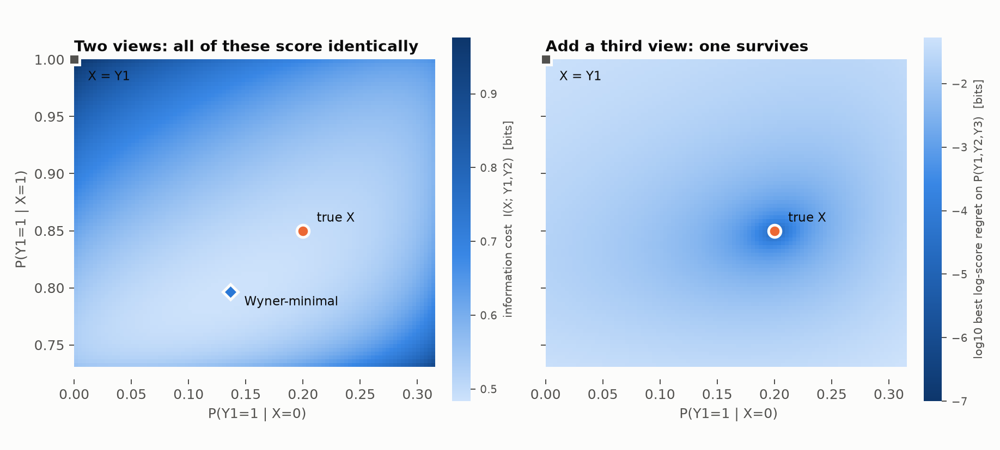

# What gives a latent belief meaning?

A probability for an observable statement gets its meaning from a proper scoring
rule applied to the outcome. A belief about a latent $X$ never meets an outcome.
So what makes one latent $X$ for observables $Y_1, Y_2$ better than another?

## Short answer

1. **A scoring rule only sees the observable marginal.** A latent model
   $(P(X), P(Y_1|X), P(Y_2|X))$ is scored only through
   $m(y)=\sum_x P(x)\prod_i P(y_i|x)$. Relabelings of $X$, and with two views a
   whole continuum of non-isomorphic latents, score identically. That includes
   $X=Y_1$.
2. **Fit is a scoring rule on the job a latent does: screening off.** If $X$ is
   coupled to $Y$, the log-score regret of the conditional-independence (CI)
   model built from it is exactly the dependence $X$ leaves unexplained:
   $\mathrm{TC}(Y|X)=\sum_i H(Y_i|X)-H(Y|X)$. With two views this is
   $I(Y_1;Y_2|X)$.
3. **Choosing among the fits is your information-bottleneck intuition, with the
   Markov chain reversed.** The right objective is the *latent bottleneck*
   $$\min_{p(x|y)}\; I(X;Y_1,\dots,Y_n)\;-\;\tau\sum_i I(X;Y_i),\qquad \tau\in[0,1).$$
   Its $\tau\to1$ limit is **Wyner's common information**. Restricting it to $X$
   computed from $Y_1$ ($X - Y_1 - Y_2$) gives exactly the **information
   bottleneck**. At $\tau=1$ it is CorEx and maximum likelihood. It is solved by
   tempered EM.
4. **That choice is a convention, not something scoring forces.** With two
   views, the minimal-information latent is typically not the true one (10 of
   10 random models), and nothing observable can tell them apart.
5. **Real meaning comes from triangulation.** With three or more conditionally
   independent views, the *fewest-states* latent is generically unique up to
   relabeling (Kruskal). Its parameters become functions of $P(Y)$, and the log
   score of the implied joint is strictly proper for them. The
   *least-information* (Wyner) latent can still differ when the views barely
   identify $X$. Adding views made the two notions of parsimony agree in every
   case tested. With
   infinitely many views, $X$ becomes a function of the observables (de
   Finetti), and no convention is needed at all.
6. **A belief about one unit's latent value** is scored through a held-out view
   it predicts. This is strictly proper exactly when the rows of that view's
   likelihood $P(Y_p|X)$ are linearly independent.

Each claim below is checked numerically in
[`experiments/latent_meaning.py`](../experiments/latent_meaning.py), with output
in [`results.txt`](results.txt), and in
[`experiments/wyner_vs_true.py`](../experiments/wyner_vs_true.py), with output in
[`wyner_vs_true.txt`](wyner_vs_true.txt).

---

## 1. Scoring sees only the fiber

Fix the observable joint $p(y_1,y_2)$. The models that reproduce it exactly
form a *fiber*. Every point on the fiber gets the same expected score under any
proper scoring rule, because the rule only evaluates $m(y)$.

For two binary views and a two-state $X$, the fiber is two-dimensional. Here
$P(Y_1,Y_2)=A\,\mathrm{diag}(\pi)\,B^\top$ is a nonnegative matrix factorization,
which is not unique.

The left panel shows 7,695 two-state models on a grid, all with log-score
regret 0 (up to $4\times10^{-16}$) on $P(Y_1,Y_2)$. They disagree about latent
facts. Across the fiber, the posterior $P(X{=}1\mid y_1{=}1,y_2{=}1)$ ranges
over $[0.83, 1.00]$; the true value is $0.95$. The corner $X=Y_1$ is on the
fiber. So "the agent's credence that $X=1$" has no observable content here,
beyond "some point on this fiber".

There are two separate sources of slack:

- **Gauge.** Relabeling $X$ changes nothing. A latent value means only "the
  state whose conditionals are these" (a Ramsey-sentence or functional-role
  semantics). Information quantities are invariant under relabeling, which is
  one reason they are the right currency for comparing latents.
- **Non-identifiability.** Distinct, non-isomorphic latents fit equally well.
  This is the real problem.

## 2. Fit = how much dependence $X$ screens off

Let $X$ be coupled to the observables by $p(x,y)=p(y)\,q(x|y)$. The CI model it
induces is $p(x)\prod_i p(y_i|x)$. Its log-score regret on the complete data is

$$\mathrm{KL}\Big(p(x,y)\,\Big\|\,p(x)\textstyle\prod_i p(y_i|x)\Big)=\sum_i H(Y_i|X)-H(Y|X)=\mathrm{TC}(Y\mid X).$$

By data processing, the regret on the observables alone is at most this. So the
scoring rule's part of the answer is: **$X$ is good to the extent that the views
are independent given $X$.** That is Reichenbach's common-cause principle, made
quantitative.

This cannot be the whole answer. $X=(Y_1,Y_2)$ and $X=Y_1$ both have zero
residual dependence. A cost on $X$ is needed.

## 3. The latent bottleneck

Trade residual dependence against the information $X$ carries:

$$\mathcal L_\beta(X)=I(X;Y)+\beta\,\mathrm{TC}(Y|X).$$

Substituting $\mathrm{TC}(Y|X)=\sum_i H(Y_i|X)-H(Y)+I(X;Y)$ and dividing by
$1+\beta$ gives, up to a constant,

$$\boxed{\;\mathcal L_\tau(X)=I(X;Y)-\tau\sum_i I(X;Y_i),\qquad \tau=\tfrac{\beta}{1+\beta}\in[0,1)\;}$$

In words: **compress the whole observable vector, while staying informative
about each view separately.** Known objects are special cases:

| Special case | What it is |
|---|---|
| $\tau\to1$ (i.e. $\mathrm{TC}(Y\mid X)=0$, then minimal $I(X;Y)$) | **Wyner's common information** $C(Y_1;\dots;Y_n)$ |
| $n=2$, $X$ restricted to $X-Y_1-Y_2$ | **Information bottleneck** $I(Y_1;X)-\beta I(X;Y_2)$, because under that chain $I(X;Y)=I(X;Y_1)$ and $I(Y_1;Y_2\mid X)=I(Y_1;Y_2)-I(X;Y_2)$ |
| $\tau=1$, $\lvert X\rvert$ bounded | CorEx (maximize $\mathrm{TC}(Y)-\mathrm{TC}(Y\mid X)$), i.e. maximum-likelihood latent class analysis |
| relaxed constraint form | relaxed Wyner common information (Gastpar & Sula) |

**Algorithm.** Bound each $p(x)$ and $p(y_i|x)$ by a free distribution, then
alternate. This gives a monotone tempered EM:
$$q(x|y)\;\propto\;p(x)\prod_i p(y_i|x)^{\tau}.$$
At $\tau=1$ it is ordinary EM. Lower $\tau$ is a higher "temperature" that
penalizes information in $X$. See
[`lvpm/latent_bottleneck.py`](../lvpm/latent_bottleneck.py).

**Why $I(X;Y)$ is the right cost.** Wyner's operational meaning: $C(Y_1;Y_2)$ is
the minimum rate of shared randomness that lets two separated parties, each
seeing only the shared message, generate $Y_1$ and $Y_2$ with the right joint.
It is the smallest common cause sufficient to produce the correlation. Bounds:
$I(Y_1;Y_2)\le C\le\min\big(H(T_1^*),H(T_2^*)\big)$, where $T_i^*$ is the minimal
sufficient statistic of $Y_i$ for the other view. That upper bound is the
information-bottleneck endpoint.

**Why the arrows matter.** The information bottleneck asks for a
*representation* computed from data ($X$ read off $Y_1$). A latent is a *cause*
that need not be computable from any single view. The cause is strictly
cheaper. For the doubly symmetric binary source (flip probability $0.1$), the
cheapest exact explanation computable from $Y_1$ is $Y_1$ itself (1 bit). The
free latent needs only $C=0.873$ bits. Numerically this matches Wyner's closed
form $1+h(p)-2h(a)$ to four decimals, and the latent curve lies below the
information-bottleneck curve at every point.

## 4. But this is a convention

On the two-view fiber above, $I(X;Y)$ ranges from 0.483 to 0.977 bits. The
Wyner-minimal two-state latent ($0.483$, blue diamond) is **not** the true one
($0.495$). Both are perfectly scored. This is typical: in 10 of 10 random
two-view models, an exact solve finds a CI latent cheaper than the true one. Picking the minimal latent is a
parsimony prior, much like choosing a minimal sufficient statistic. It is
defensible (operational meaning, MDL), but it is not something the observables
enforce. With two views, latent beliefs beyond the fiber are meaningful only
relative to such a convention.

## 5. Where real meaning comes from: more views

**Three views.** Kruskal's theorem (1977), extended to latent class models by
Allman, Matias & Rhodes (2009), says the following. If $\sum_x P(x)\prod_{i=1}^3
P(y_i|x)$ has generic conditionals and the Kruskal ranks of the three
conditional matrices satisfy $k_1+k_2+k_3\ge2r+2$, then the rank-$r$
decomposition is unique up to relabeling. Consequences:

- The latent parameters are functions of $P(Y)$.
- Log score is strictly proper for the joint, and the parameter-to-joint map is
  injective modulo relabeling. So **scoring the implied joint is strictly
  proper for the latent parameters.** A latent belief now has observable
  content.

The right panel of the figure takes the same two-view fiber and adds a third
view $Y_3$, optimizing $P(Y_3|X)$ separately for each point. Only the true
latent reaches zero regret. Every model more than $0.05$ away has regret at
least $2\times10^{-3}$ bits, and the two-view Wyner choice is refuted at
$0.0079$ bits. EM from 200 random starts recovers the true parameters to
$1.4\times10^{-8}$.

Parsimony is still needed: $X=(Y_1,Y_2,Y_3)$ is also a CI latent. What the
third view buys is that the *fewest-states* solution becomes unique. The two
parsimony conventions do not always agree, though. I computed the Wyner-minimal
latent exactly (SLSQP with the constraint that the model reproduces $P(Y)$;
violation $<10^{-9}$, best of many restarts) and compared it with the truth.
The search is local. So "cheaper than truth" is certified, because an exact
cheaper latent was exhibited. "Equal to truth" means no cheaper latent was
found.

| Setting | Wyner-minimal latent vs true latent |
|---|---|
| 2 views, 10 random models | cheaper than truth in 10/10 (gap 0.014–0.277 bits) |
| 3 ternary views, 6 random models | **equal to truth** in 6/6 |
| 3 binary views, 2-state truth (just-identified: 7 parameters, 7 degrees of freedom) | cheaper than truth in 4/4 random models (gap up to 0.165 bits), using a latent with **more states** (3 or 4) |
| two of those models plus a 4th binary view | **equal to truth** at every $\lvert X\rvert\le4$ tested |

So at the margin of identifiability, "fewest states" and "fewest bits" name
different latents. Both are exact, and both are perfectly scored. Adding views shrinks
the fiber, and in every case tested the conventions then agree. This is the
precise sense in which more observables give a latent belief more meaning:
they remove the dependence on convention. (That the conventions agree in
general under rich enough views is a conjecture suggested by these runs, not a
theorem I know of.)

**Infinitely many views.** For exchangeable $Y_1,Y_2,\dots$, de Finetti's latent
$\theta$ is the limiting empirical distribution, a measurable function of the
observables. $H(X|Y_{1..n})\to0$, so a belief about $X$ becomes a belief about an
(asymptotic) observable.

The resulting spectrum of meaning:

| Views | What the observables pin down |
|---|---|
| 2 | a fiber, plus a gauge choice. A convention (e.g. Wyner) is needed to name "the" latent |
| 3 (generic) | the fewest-states latent, up to relabeling, which is strictly scorable. Other conventions may still disagree |
| richer or more views | conventions agree in every case tested. The latent is effectively determined |
| $\infty$ | $X$ itself, as a function of the observables |

## 6. Beliefs about one unit's latent value

"This patient has the disease" is a belief about one unit's $X$, i.e. a
posterior $q(x)$ after seeing that unit's $y_1,y_2$. Score it on a held-out
probe view $Y_p$ whose likelihood $L=P(Y_p|X)$ is fixed, for example identified
at the population level as in §5. Use

$$S(q,y_p)=\log\textstyle\sum_x q(x)\,L(y_p|x).$$

This is a proper scoring rule for the predictive $qL$. It is strictly proper for
$q$ itself iff $q\mapsto qL$ is injective, i.e. iff the rows of $L$ are linearly
independent. An uninformative probe (equal rows) makes every report score the
same.

## 7. What this means for a mechanism that rewards latent beliefs

- Rewards have to flow through observable consequences: the implied joint at
  the population level, and probe views at the unit level.
- With two views, prices in latent coordinates are not pinned by incentives.
  Every point of the fiber earns the same. A mechanism must either bring in a
  third conditionally independent view, or impose a convention explicitly, for
  instance the Wyner-minimal gauge, and state that it does so.
- $\tau\sum_i I(X;Y_i)-I(X;Y)$ is a natural "value" of a proposed latent: how much
  per-view predictive information it supplies, minus what it costs to carry.

## Caveats and trade-offs

- The latent bottleneck is nonconvex. Tempered EM finds local optima; I used
  restarts and warm-starting along $\tau$. Wyner's common information is hard to
  compute in general.
- Identifiability results are generic (they fail on a measure-zero set), assume
  finite alphabets, and require knowing or bounding $|X|$.
- If an agent is uncertain about the parameters, its predictive is a mixture of
  rank-$r$ models, which generally has higher rank. The log score then elicits
  the KL projection onto rank $r$, not "the" latent.
- Two other sources of latent meaning are outside this note. One is
  **interventions**: a causal latent predicts what $do(X)$ does. The other is
  **new views not yet observed**, i.e. a latent's role in predicting variables
  beyond the ones it was fit on, which is the practical reason we posit
  latents at all.

## References

- A. Wyner, *The common information of two dependent random variables*, IEEE
  Trans. IT, 1975.
- N. Tishby, F. Pereira, W. Bialek, *The information bottleneck method*, 1999.
- M. Gastpar, E. Sula, *Relaxed Wyner's common information*, ITW 2019.
- G. Ver Steeg, A. Galstyan, *Discovering structure in high-dimensional data
  through correlation explanation* (CorEx), NeurIPS 2014.
- J. Kruskal, *Three-way arrays: rank and uniqueness of trilinear
  decompositions*, Linear Algebra Appl., 1977.
- E. Allman, C. Matias, J. Rhodes, *Identifiability of parameters in latent
  structure models with many observed variables*, Ann. Statist., 2009.
- P. Gács, J. Körner, *Common information is far less than mutual information*,
  1973. This is the other extreme: the common part *computable* from each view.
