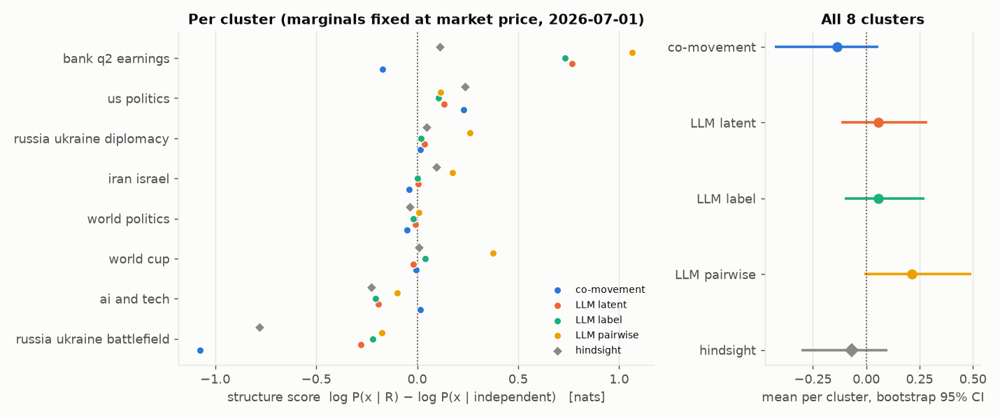
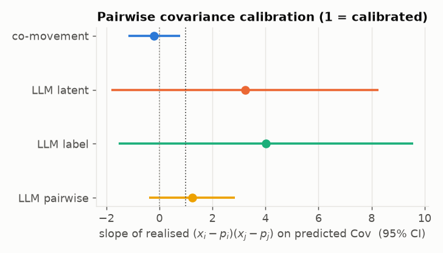
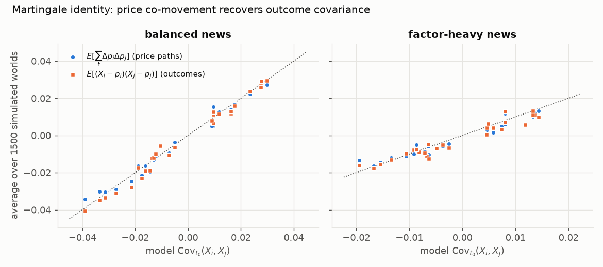
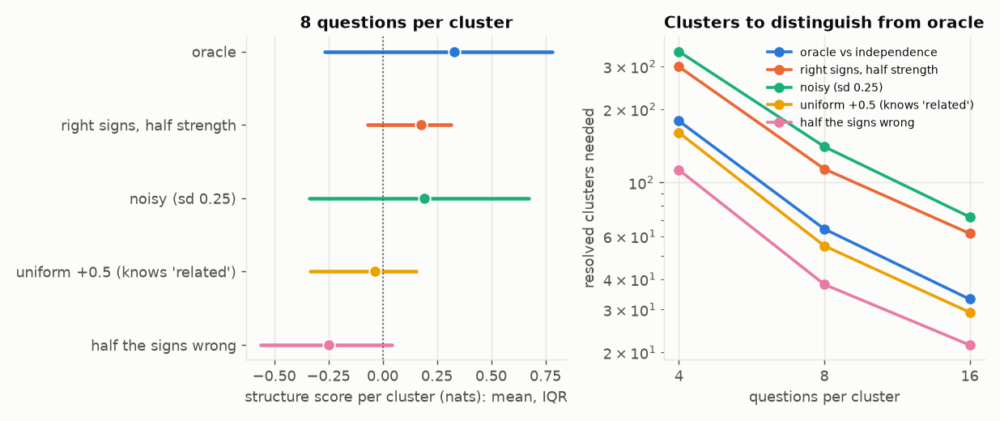

# Pilot: do LLM latent nets know how the world co-varies?

**Setup.**
- **Data.** 82 Polymarket binary questions in 8 topical clusters ([`data/pilot_clusters.json`](../data/pilot_clusters.json)).
  - Forecast date $t_0$ = 2026-07-01, which is after the forecaster's June-2026 knowledge cutoff. Questions resolved between 2026-07-04 and 2026-10-01.
  - At most one question per event, so date and threshold ladders cannot make the structure trivially logical.
  - Clusters were assigned by keyword rules on the event title, never on outcomes.
- **Forecaster.** Claude Opus 5.5 subagents, each in a fresh context, with tools forbidden. All 24 runs made 0 tool calls.
- **Scoring.** Marginals are fixed at the $t_0$ market price for every method, so only *dependence structure* is scored:

$$S = \log P(\vec x\mid p_{\text{mkt}},R_{\text{method}}) - \log P(\vec x\mid p_{\text{mkt}},I)\quad\text{[nats]}.$$

**Methods compared.**
- **LLM latent** (protocol A). The LLM names the dominant latent $Y$ and gives $P(\text{YES}\mid Y=\pm1)$ per question. This becomes a 1-factor probit IRT model.
- **LLM label** (protocol C). A fresh LLM sees *only* A's label and orientation, and must reproduce the loadings. This is the explain → simulate test.
- **LLM pairwise** (protocol B). $P(X_j\mid X_i=1)$ and $P(X_j\mid X_i=0)$ for all pairs. These become tetrachoric correlations, then the nearest correlation matrix.
- **co-movement.** Correlation of probit-scale daily price increments over the 30 days before $t_0$, shrunk towards zero.
- **hindsight.** Not a forecast; a diagnostic. The same co-movement estimate, computed from $t_0$ up to the day before each market resolved.

Reproduce with `python experiments/02_build_pilot_dataset.py && python experiments/04_score_pilot.py`. The elicitation prompts are produced by `03_make_prompts.py`; the responses are stored verbatim in `data/elicitation/responses/`.

## Results

| method | total (nats) | mean / cluster [95% bootstrap] | clusters > 0 | cov. slope ± se |
|---|---|---|---|---|
| co-movement | -1.08 | -0.135 [-0.43, +0.06] | 3/8 | -0.19 ± 0.50 |
| LLM latent | +0.44 | +0.055 [-0.12, +0.29] | 4/8 | 3.23 ± 2.57 |
| LLM label | +0.46 | +0.057 [-0.10, +0.27] | 5/8 | 4.02 ± 2.83 |
| LLM pairwise | +1.72 | +0.215 [-0.01, +0.49] | 6/8 | 1.24 ± 0.82 |
| hindsight | -0.55 | -0.068 [-0.31, +0.10] | 5/8 | 0.01 ± 0.63 |

The covariance slope is the through-origin regression of realised $(x_i-p_i)(x_j-p_j)$ on predicted $\mathrm{Cov}(X_i,X_j)$, over all 398 pairs, with standard errors robust to clustering. A slope of 1 means calibrated; 0 means no information.

### Per cluster

| cluster | n | YES | LLM's latent label | co-movement | LLM latent | LLM label | LLM pairwise | hindsight |
|---|---|---|---|---|---|---|---|---|
| bank q2 earnings | 6 | 3 | Capital markets / macro strength in Q2 | -0.17 | +0.77 | +0.73 | +1.07 | +0.11 |
| world cup | 12 | 4 | Favourites dominate the knockouts (chalk vs. upsets) | -0.01 | -0.02 | +0.04 | +0.37 | +0.01 |
| russia ukraine diplomacy | 9 | 1 | Peace-process momentum | +0.01 | +0.04 | +0.02 | +0.26 | +0.05 |
| iran israel | 12 | 2 | Iran-US/Israel de-escalation and diplomatic resolution | -0.04 | +0.01 | +0.00 | +0.17 | +0.09 |
| us politics | 12 | 4 | Trump administration assertiveness/success | +0.23 | +0.13 | +0.11 | +0.12 | +0.24 |
| world politics | 8 | 4 | Anti-incumbent / populist-right momentum and political turbulence | -0.05 | -0.01 | -0.02 | +0.01 | -0.04 |
| ai and tech | 11 | 7 | AI release velocity | +0.02 | -0.19 | -0.21 | -0.10 | -0.23 |
| russia ukraine battlefield | 12 | 3 | Russian offensive momentum (July 2026) | -1.08 | -0.28 | -0.22 | -0.18 | -0.78 |

### Agreement between protocols

| cluster | latent↔label loading corr | sign agreement | latent↔pairwise ρ corr | co-movement↔hindsight ρ corr |
|---|---|---|---|---|
| world cup | 0.98 | 100% | 0.31 | -0.04 |
| world politics | 0.90 | 100% | 0.38 | +0.18 |
| iran israel | 0.99 | 100% | 0.80 | -0.12 |
| bank q2 earnings | 1.00 | 100% | 0.93 | -0.01 |
| russia ukraine battlefield | 0.84 | 100% | 0.27 | -0.00 |
| ai and tech | 0.96 | 90% | 0.47 | -0.31 |
| us politics | 0.88 | 100% | 0.28 | +0.04 |
| russia ukraine diplomacy | 0.84 | 100% | 0.19 | -0.21 |

### Sensitivity of the co-movement baseline

All variants are reported; none was selected.

| variant | total (nats) | clusters > 0 |
|---|---|---|
| probit scale, shrink 10, 30d window | -1.08 | 3/8 |
| probit scale, shrink 10, 60d window | -0.19 | 4/8 |
| probit scale, shrink 30, 30d window | -0.45 | 4/8 |
| probit scale, shrink 30, 60d window | +0.31 | 5/8 |
| prob scale, shrink 10, 30d window | -11.25 | 6/8 |
| prob scale, shrink 10, 60d window | -0.69 | 6/8 |
| prob scale, shrink 30, 30d window | -1.59 | 5/8 |
| prob scale, shrink 30, 60d window | +1.08 | 7/8 |

## What the pilot says

**Statistics first.** The power analysis below says about 64 clusters are needed even to separate *oracle* structure from independence. Eight clusters cannot settle anything, and every 95% interval overlaps 0. Read what follows as direction, not conclusion.

1. **Pairwise elicitation was the strongest method.**
   - It scored +1.72 nats in total and was positive in 6 of 8 clusters.
   - Its covariance slope was $1.24 \pm 0.82$, consistent with calibrated dependence.
   - It caught *local* links that one shared factor cannot express. Examples: "Trump in the champions photo" needs "Trump attends the final"; a Cuba economic deal implies a Cuba meeting; Hormuz normal by July 15 implies normal by July 31; an Israeli withdrawal from Lebanon goes with an Israel–Hezbollah deal.
   - **Implication:** use factor nets *plus sparse residual links*, or bifactor models, not a single forced factor.
2. **Forcing one factor invents structure.**
   - In the grab-bag clusters (US politics, world politics), protocol A always named a common factor, e.g. "Trump administration assertiveness".
   - Asked pairwise, the same model said the questions were mostly independent.
   - The invented loadings were small, so they barely mattered here (scores of −0.01 and +0.13 nats). Still, an elicitation format that *asks* for a latent will produce one.
3. **The label carries the structure.**
   - A fresh agent given only the label reproduced the latent-net loadings: correlation 0.84–1.00, same signs.
   - It scored the same: +0.46 vs +0.44 nats.
   - So the label fixes the gauge and is enough to coordinate decomposed elicitation.
   - Caveat: both agents were the same model, so this measures *self-consistency* of meaning. Cross-model simulators and new-question prediction are the stronger tests.
4. **Raw price co-movement was not a usable teacher at this scale.**
   - With the default settings it was the worst method (−1.08 nats, slope ≈ 0).
   - Its pre-$t_0$ correlations did not correlate with the same markets' post-$t_0$ correlations (≈ 0 in every cluster).
   - Results swung by 12 nats across reasonable settings.
   - Daily increments in thin markets are mostly noise. The martingale identity is exact, as the synthetic check below shows, but estimating covariation needs liquid markets, longer windows, and regularisation chosen on held-out data.
5. **One world per cluster makes single clusters erratic.**
   - The bank cluster gave every method its biggest win. The investment-banking-fee questions all resolved YES and both credit-provision questions resolved NO, exactly the predicted factor pattern.
   - The battlefield cluster went the other way. Vasylivka (0.40) and two long shots resolved YES, while the adjacent Myrne and the 0.49 favourite Kostyantynivka resolved NO. That penalised every positive-dependence model.

## Synthetic checks ([`experiments/01_synthetic.py`](../experiments/01_synthetic.py))

**Martingale identity.** Simulated worlds use a 1-factor threshold model with Gaussian news. Measured against the true time-$t_0$ outcome covariance, $E[\sum_t\Delta p_i\Delta p_j]$ has slope balanced news: slope 0.95 | factor-heavy news: slope 0.89.

**Forecasting the time-$t_0$ structure from pre-$t_0$ co-movement:** balanced news: oracle +0.230, probit co-movement +0.202, prob-scale -0.090; factor-heavy news: oracle +0.054, probit co-movement -0.109, prob-scale -1.032.

Probit-scale co-movement recovers most of the structure when news arrives evenly. When news is mostly about the common factor, that factor is already priced in by $t_0$, and past correlations overstate what remains.

**How many clusters are needed** for 2σ detection at 80% power:

| questions / cluster | oracle E[S] (sd) | clusters: oracle vs indep. | vs half-strength | vs noisy loadings |
|---|---|---|---|---|
| 4 | 0.09 (0.44) | 179 | 299 | 346 |
| 8 | 0.33 (0.94) | 64 | 114 | 140 |
| 16 | 0.94 (1.90) | 33 | 62 | 72 |

